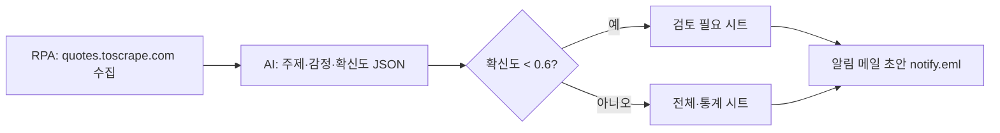

# 05. RPA + AI 파이프라인 — 수집 → 분류 → 검토 분기 → 보고

```bash
pip install requests beautifulsoup4 pandas openpyxl google-genai
python pipeline.py --pages 2
```



## 결과

- `output/quotes_report.xlsx` — 전체 / 주제별 통계 / **검토 필요** 시트
- `output/notify.eml` — 보고서가 첨부된 알림 메일 (메일 프로그램으로 열기)

## 코드에서 볼 부분

| 포인트 | 위치 |
|---|---|
| 10건씩 묶어 AI 호출 (비용·한도 절약) | `classify_with_gemini()` |
| JSON 모드로 RPA가 읽기 쉬운 결과 받기 | `response_mime_type="application/json"` |
| 확신도 낮은 건은 사람 검토 (Human-in-the-loop) | `report()` → `REVIEW_THRESHOLD` |
| AI 장애 시 규칙 기반으로 대체 | `main()` 의 try/except |

## 도전 과제

1. `04_email_document`의 SMTP 코드를 가져와 `notify.eml`을 테스트 서버로 실제 발송하기
2. Windows 작업 스케줄러(또는 cron)로 매일 오전 9시에 자동 실행되게 등록하기
