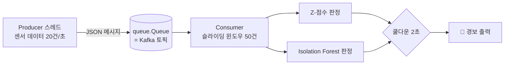

# 05. 실시간 스트리밍 이상 탐지 (무료, 로컬)

```bash
pip install numpy scikit-learn
python stream_monitor.py --seconds 15
```

```
스트리밍 시작 (15초, 초당 20건) — 처음 5초는 모델 학습용 워밍업
[모델] 초기 100건으로 Isolation Forest 학습 완료 → 실시간 판정 시작
   ⏱ 100건 처리 | 최근 50건 평균 온도 65.3℃ 진동 0.299
🚨 17:44:28 #158  온도  75.7℃ 진동 0.325  ← temp Z=5.9, ML 이상 판정
🚨 17:44:30 #190  온도  64.3℃ 진동 0.973  ← vibration Z=20.2
🚨 17:44:34 #256  온도  79.0℃ 진동 0.340  ← temp Z=9.3, ML 이상 판정

[요약] 처리 285건 | Z-점수 경보 9 | ML 경보 4 | 쿨다운으로 묶인 경보 5 | 평균 지연 13.99ms
```

## 구조



## 관찰 포인트

| 관찰 | 의미 |
|---|---|
| 처음 100건은 모델이 없음 | **워밍업**: 정상 데이터로 기준을 학습해야 판정 가능 |
| 진동 급증(Z=20)은 Z-점수만 잡고 ML은 놓치기도 함 | 방법마다 강점이 다름 → **여러 탐지 방법을 조합** |
| 이상값은 윈도우에 넣지 않음 | 이상값이 평균을 끌어올려 기준이 오염되는 것 방지 |
| "쿨다운으로 묶인 경보" | 같은 상황에 경보가 수십 번 울리는 **알림 폭주** 방지 |
| 평균 지연 ms | 메시지 생성 → 판정까지 걸린 시간 (실시간성 지표) |

## 실무로 확장하면

| 이 예제 | 실무 |
|---|---|
| `queue.Queue` | Apache Kafka, AWS Kinesis, Redis Streams |
| Consumer 클래스 | Kafka Consumer, Flink, Spark Structured Streaming |
| `print` 경보 | Slack·메일 알림, Grafana 대시보드 |
| 경보 시 메시지 | 생성형 AI로 "최근 10분 패턴 요약 + 점검 권고" 작성 |

## 도전 과제

1. `Z_LIMIT`을 2.0으로 낮추면 경보 수가 어떻게 바뀌나요? (민감도 vs 오탐)
2. 진동 특성을 `StandardScaler`로 정규화한 뒤 Isolation Forest를 학습시켜 진동 이상 탐지율을 비교해 보세요.
